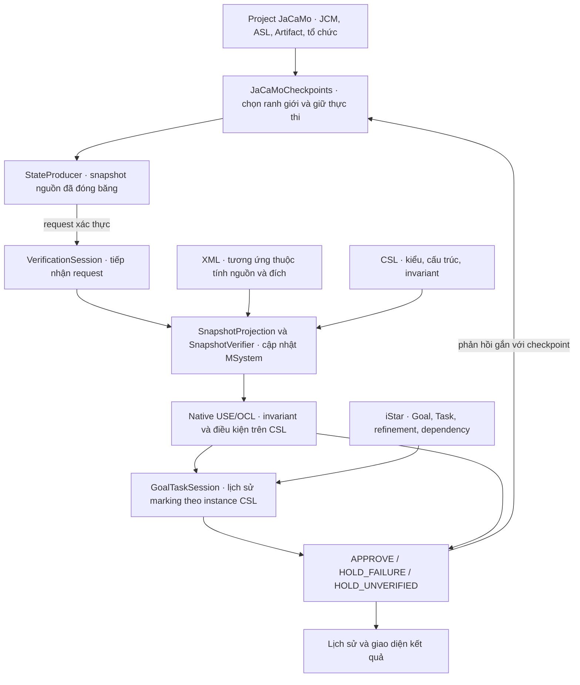

# TỔNG QUAN KHÓA LUẬN VÀ KIẾN TRÚC USE–JaCaMo

**Đề tài:** NGHIÊN CỨU MỞ RỘNG CÔNG CỤ USE HỖ TRỢ ĐẶC TẢ VÀ KIỂM CHỨNG HỆ THỐNG ĐA TÁC TỬ

**Phạm vi:** Kiến trúc `use-plugin` hiện tại, gồm đặc tả CSL/iStar, cầu nối JaCaMo, checkpoint, kiểm chứng trạng thái bằng USE/OCL và cập nhật marking Goal/Task.

**Cơ sở đối chiếu ngày 22/11/2026:** USE tại commit `c3f47cd38bb67d2de9581ab8fa221b547b326735` và checkout JaCaMo tại commit `34f45bd70350135b11e75f289fe32273267e3eaa`. Các mục [S1]–[S14] dẫn tới mã nguồn và cấu hình đối chiếu. Mục 7.3 ghi kết quả chạy Auction và replay trên bản USE đóng gói.

## 1. Tổng quan và xác nhận kiến trúc

Hệ thống đa tác tử có nhiều chủ thể thực thi đồng thời, tương tác qua thông điệp, môi trường dùng chung và tổ chức. Một chương trình có thể chạy đến cuối nhưng vẫn vi phạm ràng buộc; ngược lại, một tác tử có thể thất bại ở một hành động trong khi mục tiêu chung vẫn đạt được. Vì vậy, việc kiểm chứng cần phân biệt tính hợp lệ của trạng thái với tiến độ đạt mục tiêu.

Khóa luận nghiên cứu mở rộng USE để nối một hệ thống JaCaMo đang chạy với hai lớp đặc tả: CSL mô tả cấu trúc, dữ liệu và ràng buộc của hệ thống; iStar mô tả mục tiêu, nhiệm vụ và các quan hệ ý định. USE/OCL cung cấp cơ chế đánh giá biểu thức trên trạng thái mô hình. Plugin tổ chức việc lấy trạng thái, ánh xạ, đánh giá và phản hồi cho JaCaMo.

Mô tả “JaCaMo → CSL → iStar” **đúng về hướng dữ liệu chính**, nhưng cần bổ sung bốn điểm để chính xác với phiên bản hiện tại:

1. Plugin truyền **ảnh chụp trạng thái tại các checkpoint được chọn**, trong phạm vi nguồn và kiểu dữ liệu được hỗ trợ. Nó không sao chép toàn bộ bộ nhớ JaCaMo và không ghi nhận mọi thay đổi tức thời.
2. CSL là đặc tả được xây dựng trước. Dữ liệu runtime tạo/cập nhật các **đối tượng của mô hình CSL trong MSystem của USE**, không viết lại file `.csl` sau mỗi checkpoint.
3. iStar cũng có trước. Plugin đánh giá điều kiện Goal, tiền/hậu điều kiện Task trên trạng thái CSL, rồi dùng lịch sử marking và các quan hệ iStar để suy ra tiến độ. Nó không sinh mô hình iStar từ biến động dữ liệu.
4. Có luồng điều khiển ngược: JaCaMo giữ thực thi tại checkpoint; USE trả quyết định cho phép tiếp tục hoặc giữ dừng. Việc chọn checkpoint thuộc lớp runtime JaCaMo, độc lập với giá trị thuộc tính CSL.



Một cách phát biểu kiến trúc phù hợp cho khóa luận là: **Plugin quan sát hệ thống JaCaMo tại các ranh giới thực thi, ánh xạ ảnh chụp nguồn thành trạng thái CSL trong USE, kiểm tra invariant bằng OCL và cập nhật mức đạt Goal/Task của mô hình iStar từ chuỗi trạng thái CSL đó. Kết quả kiểm chứng điều khiển việc tiếp tục thực thi.**

<div style="page-break-after: always;"></div>

## 2. Bài toán, phương pháp và tổ chức hệ thống

### 2.1. Bài toán cần giải quyết

Đầu vào là một project JaCaMo, một đặc tả CSL, một đặc tả iStar và luật ánh xạ dữ liệu. Cần xác định tại từng checkpoint: trạng thái quan sát có phù hợp với mô hình hay không; invariant nào đúng, sai hoặc chưa đánh giá được; các Goal/Task đã có bằng chứng đạt đến đâu; và JaCaMo có được tiếp tục hay phải giữ dừng.

Khó khăn chính là khoảng cách giữa hai cách biểu diễn. JaCaMo chứa agent, artifact, workspace, tổ chức và role đang được đảm nhiệm; USE xử lý đối tượng, thuộc tính, association và OCL. Một lớp nguồn có thể có nhiều instance đang chạy. Tên giống nhau không đủ chứng minh cùng một đối tượng, và khai báo một role trong mô hình không chứng minh đã có agent đảm nhiệm role đó. Ngoài ra, một tiền điều kiện sai có thể chỉ có nghĩa “chưa đến lúc thực hiện”, khác với invariant sai.

Đây là **kiểm chứng khi thực thi trên vết quan sát được**. Plugin hiện tại không duyệt tất cả lịch thực thi, không chứng minh mọi lần chạy tương lai đều đúng và không bảo đảm phát hiện một lỗi tạm thời xuất hiện rồi biến mất giữa hai checkpoint.

### 2.2. Phương pháp và cách khởi chạy

Trong USE, chọn **Plugins → JaCaMo → Run experiment...**. Hộp thoại nhận bốn tệp bắt buộc và một thư mục tùy chọn qua `VerificationSession.Configuration`. `WorkbenchMain` dùng cùng cấu hình, với thứ tự tham số bắt buộc là `project.jcm mapping.xml model.csl model.istar`. [S1, S7]

| Đầu vào | Trách nhiệm trong đường chạy hiện tại |
|---|---|
| `.jcm` cùng các tệp ASL và tổ chức liên quan | Chương trình nguồn do JaCaMo thực thi |
| XML ánh xạ thuộc tính | Chỉ ra thuộc tính hoặc identity nguồn tương ứng thuộc tính CSL nào. Hộp thoại gợi ý `attribute-mapping.xml` cạnh `.jcm` nếu có |
| `.csl` | Khai báo mô hình cấu trúc, thuộc tính có kiểu và invariant OCL |
| `.istar` | Khai báo Goal/Task, quan hệ và điều kiện OCL đọc CSL |
| Thư mục mã Java Artifact (tùy chọn) | Chọn ở **Artifact Java sources (optional)** hoặc truyền `--artifact-source=DIR`. Mặc định là `src/env` cạnh `.jcm`. Đường dẫn tương đối tính từ thư mục chứa `.jcm` |

OCL chạy trên các biểu thức của CSL và iStar. Cấu hình phiên hiện có bốn tệp bắt buộc như bảng trên. `ProducerProcess` biên dịch các tệp Java tìm được trong thư mục Artifact vào thư mục làm việc rồi thêm kết quả vào classpath của JVM con. Có thể chạy qua CLI ở chế độ `--headless` và dùng `--seconds=N` để giới hạn thời gian phiên. [S1, S3, S5, S7]

### 2.3. Các thành phần triển khai

Repo USE có bốn Maven module gồm `use-core`, `use-gui`, `use-plugin` và `use-assembly`. Một module `use-plugin` tạo năm entry JAR cho CSL, OAL, iStar, iStarSCN và JaCaMo. Bốn JAR mở mô hình/trạng thái dùng chung triển khai trong JAR plugin chính. Phiên bản plugin lấy từ `revision` trong POM gốc, mặc định hiện là `1.0.1`. Các descriptor plugin và bản đóng gói dùng cùng giá trị. [S1, S13]

| Package | Trách nhiệm |
|---|---|
| `org.tzi.use.plugins.jacamo.entrypoint` | Đăng ký menu USE và mở cửa sổ qua `JaCaMoPlugin`, `JaCaMoExperimentAction`, `ModelPlugins`. Chứa CLI `WorkbenchMain` và `ReplayMain` |
| `org.tzi.use.plugins.jacamo.gui` | `main` chứa cửa sổ, cấu hình và điều khiển vòng đời phiên. `views` hiển thị nguồn JaCaMo, OCL và marking |
| `org.tzi.use.plugins.jacamo.runtime` | `StateProducer` chạy trong JVM con. `JaCaMoRuntime` dùng `JaCaMoLauncher`, còn `JaCaMoCheckpoints` theo dõi ranh giới thực thi |
| `org.tzi.use.plugins.jacamo.bridge` | `SourceSnapshot` mô tả dữ liệu nguồn. `mapping` đọc XML và chuẩn bị phép chiếu, `protocol` trao đổi request/response xác thực |
| `org.tzi.use.plugins.jacamo.session` | `VerificationSession` quản lý phiên, lịch sử và kết nối. `ProducerProcess` chuẩn bị JVM con. `SnapshotVerifier` sở hữu một `MSystem` của phiên và cập nhật trạng thái CSL/iStar |
| `org.tzi.use.plugins.jacamo.verify` | `verify.use75` biên dịch CSL sang mô hình USE và đánh giá OCL. `verify.istar` xử lý admission, topology và phiên Goal/Task. `verify.api` khai báo profile, chẩn đoán và quyền sở hữu mô hình |
| `org.vnu.sme.goal.dsl` và `org.vnu.sme.goal.verify` | Frontend, parser, metamodel và diagram của DSL. Phần kiểm chứng gom ngữ nghĩa Goal/Task trong `verify.istar.IStarMarking` và kiểm tra tĩnh CSL trong `verify.csl` |

JaCaMo thực thi chương trình nguồn trong JVM riêng, sử dụng các JAR runtime có hỗ trợ checkpoint. Bản USE đóng gói mang các JAR này tại `bridge/state`. Bản JaCaMo thực sự dùng khi chạy phụ thuộc classpath đã nạp. Chỉnh source ở repo `jacamo` cần build và nhập lại runtime tương ứng để thay đổi có hiệu lực trong bản USE. [S5, S11, S13]

<div style="page-break-after: always;"></div>

## 3. Thuật toán ánh xạ và dựng trạng thái CSL

### 3.1. XML mô tả tương ứng, không thay thế đặc tả

`AttributeMapping` đọc XML theo namespace `urn:use:jacamo-state-mapping:1`. Một nguồn có dạng `category:sourceType/property:member` hoặc `category:sourceType/identity:member`; đích có dạng `CslType.attribute`. Các category được hỗ trợ là `artifact`, `agent`, `organization`, `group`. Identity hỗ trợ `name`, `uuid`, `workspace`. Parser từ chối mapping trùng đích hoặc một kiểu CSL có nguồn instance mơ hồ. [S2]

Ví dụ thực trong Auction, **trích từ file mapping**:

```xml
<attribute source="artifact:auction_env.AuctionArtifact/property:best_bid" target="Auction.best_bid"/>
<attribute source="artifact:auction_env.AuctionArtifact/property:winner" target="Auction.winner"/>
```

Khi nguồn có nhiều artifact thuộc lớp này, cùng luật được áp dụng cho từng instance. XML không chứa giá trị winner mong đợi, không quyết định kết quả kiểm chứng và không ánh xạ một plan Jason sang Task iStar. Ví dụ chỉ minh họa cấu hình của Auction; thuật toán xử lý dùng category, kiểu, identity và khai báo mô hình. [S2, S12]

### 3.2. Lấy dữ liệu nguồn

`StateProducer` duyệt agent đang tồn tại và cây workspace CArtAgO cục bộ. Nó thu các Artifact thuộc kiểu Java có trong mapping, thuộc tính quan sát, danh sách observer, các OrgBoard/GroupBoard và dữ kiện tổ chức. Kiểu agent lấy từ tên tệp ASL. Kiểu tổ chức lấy từ `id` của đặc tả Moise, còn kiểu group lấy từ đặc tả group. Snapshot ghi membership group–cha và role enactment riêng. UUID của Artifact và identity agent trong phiên được giữ riêng với tên hiển thị. [S5]

Giá trị `winner` của Auction được đọc từ observable property của Artifact. Belief, plan, intention và outcome thực thi được đưa vào phần kiểm tra nguồn hoặc metadata để hiển thị và phân tích vết. Đầu vào của OCL và Goal/Task là trạng thái CSL đã chiếu từ snapshot. [S3, S5, S12]

Observable property được thu khi chứa một giá trị hỗ trợ, gồm String, Boolean, Number, atom đơn hoặc enum Java. Atom đơn được chuyển thành tên functor, còn enum Java được chuyển bằng `Enum.name()`. Remote workspace bị từ chối. Property dạng cấu trúc và dữ liệu nội bộ chưa công bố cần cơ chế quan sát phù hợp. [S4, S5]

### 3.3. Phép chiếu có kiểu và identity

`SnapshotProjection.prepare` lập chỉ mục theo identity nguồn, ghép cặp category/kiểu nguồn với mapping, rồi chuẩn bị danh sách object và link trước khi `SnapshotVerifier` cập nhật USE. Artifact ánh xạ sang Entity. Agent, organization và group ánh xạ sang OrgContext, mỗi instance nguồn thuộc nhóm này chỉ có một kiểu đích chuẩn. Thuộc tính đích phải tồn tại và có thể gán. Các thuộc tính đích dẫn xuất được mô hình USE tính từ trạng thái. [S3, S4]

Phép chiếu kiểm tra giá trị theo kiểu đích. Integer phải biểu diễn đúng dưới dạng số nguyên 32 bit, Real phải hữu hạn, String và Boolean phải đúng kiểu. Với enum CSL, `Use75ValueCodec.decodeEnum` tạo giá trị enum USE từ chuỗi đúng tên literal đã khai báo. Thiếu giá trị, lệch kiểu hoặc literal enum không hợp lệ khiến phiên live trả `HOLD_UNVERIFIED` khi xử lý request. [S4, S7]

Khóa đối tượng được tạo theo bộ `run + sourceIdentity + targetType`. Do đó, hai phiên Auction có identity khác nhau có hai đối tượng CSL và hai lịch sử marking riêng; không nhập làm một chỉ vì dùng chung một lớp. Các bảng map tra cứu identity giúp tìm lại đúng đối tượng qua nhiều snapshot.

Sau thuộc tính, projection dựng association cấu trúc: focus từ observer thực; membership từ quan hệ thành viên thực; role occurrence từ enactment thực, nối qua `Plays` và `InContext`; scope từ vị trí nguồn và khai báo CSL. Nó không tự sinh agent hoặc role player chỉ vì chúng được khai báo trong DSL. Scope thiếu hoặc có nhiều ứng viên bị từ chối. Association nghiệp vụ tường minh tùy ý hiện cần provider riêng; đường này chưa hỗ trợ tổng quát chúng. [S4]

**Mã giả diễn giải thuật toán:**

```text
Đọc các source của snapshot và kiểm tra identity
Với mỗi source:
    Ghép các luật có cùng category và sourceType
    Đọc thuộc tính/identity, chuyển đúng kiểu CSL
    Tạo hàng đối tượng với khóa (run, sourceIdentity, targetType)
Dựng focus, scope, membership và enactment từ dữ kiện nguồn
Từ chối kiểu/giá trị/scope không xác định; trả danh sách object và link
```

Đây là phép chiếu dựa trên tương ứng khai báo và dữ liệu runtime. Nó không dùng học máy hay suy luận tên miền để đoán quan hệ còn thiếu.

<div style="page-break-after: always;"></div>

## 4. Thuật toán chọn checkpoint và giữ thực thi

### 4.1. Checkpoint nằm ở đâu?

`JaCaMoCheckpoints` không đọc XML mapping, CSL, iStar hay giá trị thuộc tính. Quy tắc đang triển khai là: [S6]

| Ranh giới | Xử lý hiện tại |
|---|---|
| Khởi tạo | Kiểm tra snapshot trước khi bắt đầu thực thi agent |
| Plan gốc kết thúc | Tạo checkpoint cho nhóm plan gốc và plan con đồng bộ |
| Plan độc lập/intention mới, gồm `!!Goal` | Có nhóm thực thi và checkpoint riêng |
| Gửi message sang agent khác | Giữ trước khi giao message và tạo checkpoint chuyển giao |
| Message cuối plan | Có thể ghép việc phê duyệt kết thúc plan với giao message; ask chờ trả lời được xử lý riêng để tránh chờ vòng |
| Thất bại/hủy | Quan sát kết thúc thất bại/hủy; lỗi goal không có plan tương ứng cũng có checkpoint |
| Không bảo đảm quan sát nguồn | Đánh dấu unavailable để giữ dừng |

Monitor chèn marker đầu/cuối plan để theo dõi nhóm thực thi. **Marker đầu plan không đồng nghĩa tự động có checkpoint trước mọi Task.** Một chuỗi plan con gọi đồng bộ trên cùng intention được gom vào nhóm gốc; chỉ khi nhóm kết thúc mới có checkpoint tương ứng. Vì vậy, bản hiện tại không đơn giản là “mỗi Task bắt đầu thì dừng”, cũng không phải “mỗi thuộc tính CSL thay đổi thì tạo một State”.

Một checkpoint có thể có CSL giống checkpoint trước vì ranh giới thực thi vẫn xảy ra. Ngược lại, nhiều biến đổi xảy ra bên trong nhóm có thể chỉ xuất hiện dưới dạng một trạng thái cuối nhóm. Đây là lựa chọn độ hạt quan sát, có ảnh hưởng trực tiếp đến khả năng phát hiện lỗi.

### 4.2. Giữ dừng có phối hợp

Checkpoint đóng admission của thực thi nguồn qua `ExecutionBarrier`, để các bước đã được cấp quyền và công việc thuộc hàng đợi được theo dõi đạt trạng thái quiescent. Bước nguồn chờ giao message nhường permit của mình trước khi đợi. Khi đồng hồ logic đã đóng băng, `awaitFrozen` trả về proof của epoch hiện tại. `StateProducer` kiểm tra proof có đúng run, admission đã đóng, không còn hoạt động hoặc công việc đang chờ được theo dõi, rồi mới lấy snapshot. [S5, S6, S11]

**Trích mã nguồn** phần xử lý hàng đợi khi đã có proof `cut`:

```java
Pending next;
synchronized (this) {
    next = pending.pollFirst();
    if (next == null) { ExecutionBarrier.release(epoch); draining = false; return; }
}
boolean approved = handler.verify(next.checkpoint(), cut);
next.result().complete(approved);
if (!approved) return; // No timeout, console action or failed transport may resume the source.
```

Worker gọi bộ kiểm chứng bên ngoài khối synchronized. Các checkpoint đang chờ trong cùng đợt giữ có thể dùng chung epoch, mỗi request vẫn mang token và sequence riêng. Worker mở admission khi các checkpoint trong đợt đã được chấp thuận và hàng đợi rỗng. Checkpoint khởi tạo đóng và mở admission riêng trước khi bắt đầu agent. [S6]

Bảo đảm đóng băng áp dụng cho hoạt động đi qua hook của runtime hỗ trợ, gồm các bước Jason, thao tác CArtAgO và công việc bất đồng bộ được registry của barrier theo dõi. Phần thời gian đình chỉ bị loại khỏi đồng hồ logic của các hook; luồng TCP kiểm chứng và USE vẫn hoạt động. Thread tự tạo, nguồn từ xa và đồng hồ vật lý nằm ngoài bảo đảm này. [S5, S6, S11]

### 4.3. Phê duyệt đúng checkpoint

`CheckpointProtocol` dùng phiên bản live `CSL_STATE_SYNC/3.0`, truyền JSON chuẩn hóa trong khung có giới hạn qua TCP loopback và xác thực bằng HMAC-SHA256. Mỗi request mang run, token, snapshot và định danh điểm đóng băng (`cut`). `cut` gồm policy `JASON_PLAN_BOUNDARIES/1`, scope `local-session:<run>`, epoch của barrier và revision. Revision được tính từ nội dung CSL/iStar, tệp `.jcm` và các tương ứng thuộc tính đã đọc từ XML. Mã ASL, mã Java và đường dẫn thư mục Artifact nằm ngoài phép băm revision này. [S5, S7, S8]

Phía nguồn chỉ chấp nhận `APPROVE` khi phản hồi đã xác thực và khớp version, run, token, hash request và toàn bộ `cut`; hash payload kết quả phải đúng, và quyết định trong payload phải đồng nhất với quyết định của phản hồi. USE giữ receipt trong phiên theo `run:token`. Request lặp cùng nội dung dùng lại phản hồi; cùng khóa nhưng khác nội dung bị từ chối. Timeout, phản hồi sai định danh, lỗi giao thức hoặc quyết định HOLD khiến admission tiếp tục đóng. Nếu checkpoint khởi tạo bị từ chối, JaCaMo dừng khởi tạo trước khi chạy agent. Người dùng có thể dừng hoặc khởi động lại phiên từ giao diện. Đường này chưa cung cấp thao tác chấp thuận thủ công để nhả một checkpoint. [S5–S8]

<div style="page-break-after: always;"></div>

## 5. Thuật toán cập nhật USE và kiểm tra OCL

### 5.1. Thứ tự cập nhật một snapshot

`SnapshotVerifier.update` nhận snapshot theo run và sequence. Sequence bắt đầu từ 1 và tăng liên tiếp trong phiên. Bản lặp của snapshot đã ghi nhớ trả lại kết quả cũ nếu nội dung giống hệt. Trùng sequence nhưng lệch nội dung, nhảy sequence hoặc đổi run được báo lỗi. Snapshot có `complete=false` nhận `HOLD_UNVERIFIED` trước khi chiếu dữ liệu vào `MSystem`. [S3]

**Mã giả diễn giải đường cập nhật hiện tại:**

```text
Kiểm tra run, sequence và cờ complete của snapshot
Chuẩn bị projection: giải hết identity, scope và kiểu
Sao chép trạng thái CSL trước cập nhật
Tạo/tìm object USE và gán các giá trị mới
Xóa link cũ
Xóa object vắng mặt và đóng lịch sử Goal/Task tương ứng
Dựng lại link từ projection
Đánh giá các invariant trên object thuộc classifier tương ứng
Đánh giá điều kiện Goal/Task với self là instance ngữ cảnh
Với mỗi context có kết quả check xác định: cập nhật marking và lan truyền iStar
Tổng hợp quyết định; ghi nhớ snapshot và kết quả
```

Phép chiếu xử lý identity, scope và kiểu trước khi thay đổi dữ liệu. Khi áp dụng, verifier thay đổi trực tiếp `MSystem`; tính nguyên tử của một bước cập nhật lịch sử trong `GoalTaskSession` chỉ áp dụng cho marking của phiên đó. Đường chạy hiện tại có thể trả HOLD sau lỗi giữa chừng trong khi `MSystem` đã thay đổi một phần. [S3, S4, S10]

### 5.2. Trạng thái hiện tại và trạng thái trước

**Trích mã nguồn** tại vị trí lưu ảnh trước và áp dụng snapshot:

```java
MSystemState before=new MSystemState("previous-csl-state",system.state());
applySnapshot(prepared);

var view = StateView.pin(before, system.state());
```

`CslModelCompiler` tạo mô hình USE từ CSL, cùng các association quan sát do `CslContextSchema` cài đặt. `NativeOclBackend` biên dịch biểu thức với đúng kiểu `self`, sau đó đánh giá trên ảnh trước và sau khi áp dụng snapshot. `@pre` đọc ảnh CSL ngay trước lần cập nhật. Một nhóm plan có nhiều operation vẫn dùng cặp ảnh snapshot này cho việc đọc trước/sau. [S3]

Ví dụ trong Auction, Goal `BidNeverIncreases` kiểm tra giá tốt nhất ở ảnh hiện tại không lớn hơn ảnh trước; đối tượng mới được tạo có nhánh xử lý riêng vì chưa có giá trị trước đó. Điều này chứng minh tính chất giữa các ảnh quan sát, không chứng minh giá chưa từng tăng tạm thời ở bên trong khoảng giữa chúng. [S12]

### 5.3. Phạm vi context và lịch sử

`SnapshotVerifier` buộc mọi actor trong một graph iStar quy về cùng một kiểu context CSL. Tác giả có thể khai báo mặc định bằng `// @csl-state Auction`, đặt binding tường minh bằng `// @csl-context <Actor> = <Type>` hoặc dùng tên actor làm mặc định khi thiếu khai báo chung. Các binding cuối cùng phải cùng một kiểu và kiểu đó phải có nguồn trong XML. Trộn hai kiểu sẽ bị từ chối với `STATE_ISTAR_REQUIRES_ONE_CSL_CONTEXT_TYPE_PER_GRAPH`. [S3]

Mỗi instance của kiểu đó có một `GoalTaskSession` theo identity riêng. Hai đối tượng Auction `a1`, `a2` tạo hai lịch sử độc lập. Một Entity CSL kiểu khác vẫn có thể ảnh hưởng đến điều kiện của cả graph qua association được hỗ trợ hoặc `allInstances()` khi đã được chiếu vào cùng `MSystem`. Có thể kiểm tra invariant trên nhiều kiểu CSL trong cùng snapshot. [S3, S4]

Native OCL phân biệt `PASS` và `FAIL` với `UNDEFINED`, `ERROR` và `SKIPPED`. Nếu có check chưa xác định ở một context, verifier giữ lịch sử marking của context đó và bỏ qua bước tiến marking tại snapshot ấy. Các check chưa xác định vẫn được tổng hợp vào quyết định toàn checkpoint. Cờ `complete` biểu thị độ đầy đủ của quan sát nguồn. Nếu chưa có instance của kiểu context, sẽ chưa có marking cho graph; các invariant có đối tượng áp dụng vẫn được đánh giá. [S3]

### 5.4. Lưu, hiển thị và replay

USE ghi cặp request/response vào `latest.json` và nối vào `consumer-history.jsonl` trước khi gửi phản hồi. Phía nguồn ghi `checkpoint-<sequence>.json` sau khi kiểm tra phản hồi. Session chuyển kết quả cho listener giao diện. Lỗi trình bày được ghi log; quyết định vẫn do verifier cung cấp. Cặp request lặp đúng nội dung dùng lại receipt và giữ nguyên lịch sử Goal/Task. [S5, S7]

Cửa sổ thực nghiệm hiển thị nguồn JaCaMo, kết quả OCL và marking, đồng thời cung cấp Stop và Restart cho phiên. Các file `.oal` và `.iscn` xuất từ giao diện là snapshot XML `use-model-state` v1, có tham chiếu mô hình và nội dung trạng thái tương ứng. Mở chúng để xem lại trạng thái đã lưu. [S1, S14]

`ReplayMain` nhận `mapping.xml model.csl model.istar history.jsonl output.json`, nạp một verifier mới và đánh giá lại snapshot theo sequence cho đến checkpoint HOLD đầu tiên hoặc hết lịch sử. Nó hỗ trợ đọc trace 2.0 và 3.0, xuất `fulfilledElements` với context, actor và phần tử. Replay có phạm vi là tiền tố đã ghi, kể cả khi thay đặc tả khiến quyết định khác với lần live. [S8, S14]

<div style="page-break-after: always;"></div>

## 6. Thuật toán đánh giá Goal/Task và quyết định tiếp tục

### 6.1. Task: ghi nhớ đã gặp tiền điều kiện và hậu điều kiện

Trong `org.vnu.sme.goal.verify.istar`, `IStarMarking.java` gom marking, recurrence và lan truyền của Goal/Task. Phần marking kiểm chứng hiện có Goal và Task. `QualityStatus` đã được bỏ khỏi engine; cú pháp và mô hình tĩnh iStar vẫn có thể biểu diễn Quality và Resource. `SnapshotVerifier` từ chối Quality, Resource và quan hệ `needed-by` khi nạp cho luồng kiểm chứng từ CSL. [S3, S9, S14]

Mỗi Task có marking `(Q,R)`: `Q` ghi nhớ đã thấy tiền điều kiện đúng; `R` ghi nhớ đã thấy hậu điều kiện đúng khi đã có tiền điều kiện. **Trích mã nguồn** từ `IStarMarking.TaskMarking`: [S9]

```java
public TaskMarking update(boolean required, boolean pre, boolean post) {
    if (!required) return this;
    boolean nextQ = preSeen || pre;
    boolean nextR = postSeen || (nextQ && post);
    return new TaskMarking(nextQ, nextR);
}
```

```java
public GoalTaskStatus status() {
    if (postSeen) return GoalTaskStatus.FULFILLED;
    return preSeen ? GoalTaskStatus.PENDING : GoalTaskStatus.UNKNOWN;
}
```

Do đó: chưa thấy tiền điều kiện → `UNKNOWN`; đã thấy tiền điều kiện nhưng chưa có hậu điều kiện → `PENDING`; đã có chuỗi bằng chứng phù hợp → `FULFILLED`. Tiền và hậu điều kiện cũng có thể cùng đúng ở một snapshot và khiến Task fulfilled ngay. Khi `required=false`, lịch sử được giữ nguyên.

**Task trong recurrence này không có trạng thái `VIOLATED`.** Không được diễn giải `PENDING` thành “thực thi thất bại”. Mặt khác, marking ghi nhận bằng chứng theo lịch sử context; nó không tự chứng minh một agent cụ thể đã gọi đúng operation, hay tiền/hậu điều kiện thuộc cùng một invocation. Việc đổi nhãn UI thành Unknown/Complete/Incomplete không thể thay thế việc xác định ngữ nghĩa này.

Trong Auction hiện tại, Task `ObserveBid` dùng điều kiện giá tốt nhất đã giảm khỏi giá trị khởi tạo. Đây là bằng chứng có ít nhất một bid cải thiện giá; không phải chứng nhận mọi participant đã bid. Một lời bid không tốt hơn có thể thực thi thành công nhưng không làm thay đổi `best_bid`. [S12]

### 6.2. Goal: loại mục tiêu quyết định cách ghi nhớ và vi phạm

`GoalMarking` lưu trạng thái active, giá trị điều kiện và tính ổn định lịch sử. **Trích mã nguồn** phần cập nhật cốt lõi: [S9]

```java
boolean nextP = type == GoalType.ACHIEVE
        ? ((!entering && condition) || predicate)
        : predicate;
boolean previousS = entering ? true : stable;
boolean nextS = previousS && (!previousP || nextP);
return new GoalMarking(type, true, nextP, nextS);
```

`Achieve` ghi nhớ một lần đạt điều kiện trong episode; chưa đạt là `PENDING`. `Maintain` yêu cầu điều kiện đúng và ổn định. Điều kiện sai có thể khiến Goal `VIOLATED` ngay lần đầu. `Sustain` cho phép điều kiện chưa đạt ban đầu, nhưng sau khi đã đạt rồi đánh mất điều kiện thì `VIOLATED`. Goal chưa active có trạng thái `UNKNOWN`. Trong luồng CSL hiện tại, Goal có điều kiện trực tiếp và được đánh giá như lá nhận `active=true` khi context đủ dữ liệu. [S3, S9]

### 6.3. Lan truyền trên mô hình ý định

`GoalTaskSession.step` cập nhật lịch sử Goal/Task lá. Từ lịch sử đó, nó tạo marking tổng hợp, gọi `IStarMarking.closePending`, bão hòa qua `assignGoalTask`, lan truyền fulfillment theo dependency qua `GoalModelInstanceTranslator.propagateDependencies`, rồi đóng các trạng thái pending một lần nữa. Marking dẫn xuất được tính ở bước tổng hợp; lịch sử các lá được giữ riêng. [S9, S10]

Refinement AND cần tất cả nhánh fulfilled để fulfilled và có thể truyền vi phạm từ một nhánh. Refinement OR đạt khi có ít nhất một nhánh fulfilled. Các phép này tổng hợp phần tử trong graph của một context. Dependency truyền fulfillment từ phần tử ở phía dependee sang phía depender. [S9]

`GoalModelTopology.ParticipationViews` cho phép Goal cùng tên cục bộ, cùng loại qua `participates-in` dùng chung marking khi Goal phía Role là lá chưa có triển khai và chỉ có một provider phù hợp. Nhiều provider khiến mô hình bị từ chối vì mơ hồ. Trong Auction, các Goal phía role `Auctioneer` và `Participant` dùng các Goal tương ứng của `auction_capabilities`; các dependency đã khai báo đi tiếp tới các nhánh của `AuctionCompleted`. [S10, S12]

### 6.4. Quyết định checkpoint khác với kết quả hoàn thành mục tiêu

**Trích mã nguồn** tại `SnapshotVerifier.update`: [S3]

```java
boolean failed=checks.stream().anyMatch(c->c.kind().equals("CSL_INVARIANT")&&c.verdict().equals("FAIL"))||elements.stream().anyMatch(e->e.status().equals("VIOLATED"));
boolean unavailable=checks.stream().anyMatch(c->!Set.of("PASS","FAIL").contains(c.verdict()));
var result=new Result(snapshot.sequence(),failed?"HOLD_FAILURE":unavailable?"HOLD_UNVERIFIED":"APPROVE",checks,elements,stateRows());
```

| Quyết định | Ý nghĩa chính xác |
|---|---|
| `HOLD_FAILURE` | Có invariant CSL sai hoặc trạng thái iStar `VIOLATED`. Vi phạm đã xác định được ưu tiên khi cùng checkpoint còn có check chưa xác định |
| `HOLD_UNVERIFIED` | Không đủ cơ sở kiểm chứng, như dữ liệu/biểu thức chưa xác định hoặc lỗi xử lý request |
| `APPROVE` | Các check hiện có đủ xác định và không có vi phạm theo quy tắc trên; được tiếp tục |

`APPROVE` **không có nghĩa mọi Goal/Task đã complete**. Task pending hay Goal Achieve chưa đạt là tiến độ chưa hoàn tất, không tự trở thành vi phạm. Outcome `FAILED` của plan nằm trong metadata nguồn, không được đưa trực tiếp vào evaluator để ép iStar violated. Vì vậy, một lỗi plan chỉ bị phản ánh thành vi phạm khi đặc tả trên CSL đủ sức diễn đạt và quan sát hậu quả của nó. Đây vừa là chủ trương tách dữ liệu khỏi kết luận, vừa là giới hạn cần nêu rõ khi đánh giá độ bao phủ của công cụ.

<div style="page-break-after: always;"></div>

## 7. Đóng góp, giới hạn và danh sách kiến thức nền tảng

### 7.1. Đóng góp được phản ánh trong source

Đóng góp của khóa luận nằm ở cầu nối giữa thực thi JaCaMo và đặc tả/kiểm chứng trong USE: frontend và tích hợp DSL; hợp đồng ánh xạ thuộc tính ngắn gọn; phép chiếu cấu trúc runtime có identity; cơ chế checkpoint phản hồi; kết nối native OCL với lịch sử marking iStar; và hiển thị trạng thái cùng kết quả kiểm chứng. Các recurrence và compiler được tái sử dụng cần được ghi nguồn rõ, không trình bày toàn bộ như thuật toán mới do khóa luận đề xuất.

Tính dùng lại đến từ việc thuật toán đọc kiểu, identity, mô hình và mapping thay vì đặt sẵn tên agent hay kết quả của Auction. Tuy nhiên, **không thể từ đó kết luận đã hỗ trợ mọi case study**. Một project chỉ nằm trong phạm vi hiện tại khi nguồn quan sát, kiểu dữ liệu, association và điều kiện của nó đáp ứng những hợp đồng đã triển khai.

Phạm vi kiểm chứng giới hạn ở snapshot biên, dữ liệu quan sát được và ràng buộc đã khai báo. Task ghi nhận bằng chứng qua các snapshot. Mỗi graph iStar dùng một kiểu context và có thể có nhiều instance. Luồng live hiện hỗ trợ marking Goal/Task, các association cấu trúc đã cài đặt và workspace cục bộ. Các lớp nguồn, quan hệ và thuộc tính ngoài hợp đồng đó cần bổ sung khả năng quan sát hoặc chiếu dữ liệu. [S3–S6, S9]

### 7.2. Đề mục kiến thức nền tảng đề xuất

1. Hệ thống đa tác tử: agent, tương tác, môi trường, tổ chức và mục tiêu.
2. Kiến trúc BDI và AgentSpeak/Jason: belief, event, goal, plan, intention.
3. JaCaMo: phối hợp Jason, CArtAgO và Moise; artifact, workspace, scheme, mission, role.
4. Ngôn ngữ đặc thù miền (DSL), metamodel và phân biệt kiểu với instance.
5. ANTLR: grammar, lexer/parser, parse tree, visitor và kiểm tra ngữ nghĩa.
6. CSL: OrgContext, Role, Entity, enactment, membership, scope và invariant.
7. UML/OCL và USE: mô hình lớp, object/link, MSystem, Boolean/undefined, trạng thái trước/sau và `@pre`.
8. iStar: actor/agent/role, Goal/Task, refinement và dependency.
9. Ngữ nghĩa marking Goal/Task: Achieve, Maintain, Sustain, lịch sử và lan truyền kết quả.
10. Ánh xạ mô hình và phép chiếu runtime: định danh, bảo toàn kiểu, đồng bộ object/link.
11. Kiểm chứng khi thực thi: trace, snapshot, checkpoint, tính chất an toàn và tiến độ.
12. Đồng thời và giao thức checkpoint: admission, quiescence, logical clock, thứ tự, xác thực và idempotence.

### 7.3. Đối chiếu bằng một phiên Auction và replay

Ngày 22/11/2026, bản USE 7.5.0 với plugin 1.0.1 trong `use-assembly/target/new` chạy qua `WorkbenchMain --headless`. Đầu vào dùng bản sao tạm của `jacamo/examples/auction` và CSL, iStar, mapping đi kèm plugin. Thư mục Java Artifact trên bản sao được chuyển sang `artifact-java` để kiểm tra `--artifact-source=artifact-java`. Classpath thực thi dùng các JAR trong `bridge/state`; `jacamo-1.3.1-checkpoint-SNAPSHOT.jar` có SHA-256 `dede2e2cde568c747a774e33f821cdcee6501515997a710816aa9c02c7c901f5`, trùng JAR được lưu trong `use-plugin/lib/checkpoint`. [S1, S12, S13]

| Kiểm tra | Kết quả lần chạy này |
|---|---|
| Live qua CLI | 58 checkpoint có phản hồi `APPROVE` và receipt phía nguồn, dùng `CSL_STATE_SYNC/3.0` và `JASON_PLAN_BOUNDARIES/1` |
| Goal cuối của hai context Auction | `AuctionCompleted = FULFILLED` ở hai context phân biệt |
| Replay từ `consumer-history.jsonl` | Đánh giá lại 58 checkpoint, không có HOLD, tái hiện hai context `AuctionCompleted` |
| Đóng phiên CLI theo thời gian đã đặt | JVM con đã dừng và tệp credential tạm đã được xóa |

Số checkpoint là kết quả quan sát của lần chạy này và có thể thay đổi theo luồng thực thi. Bằng chứng ở mục này gồm phiên JaCaMo thật qua CLI và replay trên vết đã ghi. Các mô tả menu và cửa sổ trong tài liệu dựa trên source.

### 7.4. Chỉ mục nguồn đối chiếu

Các đường dẫn trỏ đến checkout được đọc. Commit ở đầu tài liệu xác định phiên bản đối chiếu.

- **[S1] Kiến trúc và cách chạy** — [README.md](D:/_CODE_BANK/Project_/08_Thesis/use/README.md), [ARCHITECTURE.md](D:/_CODE_BANK/Project_/08_Thesis/use/doc/ARCHITECTURE.md), [RunDialog.java](D:/_CODE_BANK/Project_/08_Thesis/use/use-plugin/src/main/java/org/tzi/use/plugins/jacamo/gui/main/RunDialog.java), [WorkbenchMain.java](D:/_CODE_BANK/Project_/08_Thesis/use/use-plugin/src/main/java/org/tzi/use/plugins/jacamo/entrypoint/WorkbenchMain.java).
- **[S2] Hợp đồng XML** — [AttributeMapping.java](D:/_CODE_BANK/Project_/08_Thesis/use/use-plugin/src/main/java/org/tzi/use/plugins/jacamo/bridge/mapping/AttributeMapping.java).
- **[S3] Biên dịch CSL, cập nhật phiên và đánh giá native OCL** — [SnapshotVerifier.java](D:/_CODE_BANK/Project_/08_Thesis/use/use-plugin/src/main/java/org/tzi/use/plugins/jacamo/session/SnapshotVerifier.java), [CslModelCompiler.java](D:/_CODE_BANK/Project_/08_Thesis/use/use-plugin/src/main/java/org/tzi/use/plugins/jacamo/verify/use75/CslModelCompiler.java), [CslContextSchema.java](D:/_CODE_BANK/Project_/08_Thesis/use/use-plugin/src/main/java/org/tzi/use/plugins/jacamo/verify/use75/CslContextSchema.java), [NativeOclBackend.java](D:/_CODE_BANK/Project_/08_Thesis/use/use-plugin/src/main/java/org/tzi/use/plugins/jacamo/verify/use75/NativeOclBackend.java).
- **[S4] Phép chiếu nguồn sang CSL** — [SnapshotProjection.java](D:/_CODE_BANK/Project_/08_Thesis/use/use-plugin/src/main/java/org/tzi/use/plugins/jacamo/bridge/mapping/SnapshotProjection.java), [Use75ValueCodec.java](D:/_CODE_BANK/Project_/08_Thesis/use/use-plugin/src/main/java/org/tzi/use/plugins/jacamo/verify/use75/Use75ValueCodec.java).
- **[S5] Bộ thu nguồn và khởi chạy JaCaMo** — [StateProducer.java](D:/_CODE_BANK/Project_/08_Thesis/use/use-plugin/src/main/java/org/tzi/use/plugins/jacamo/runtime/StateProducer.java), [JaCaMoRuntime.java](D:/_CODE_BANK/Project_/08_Thesis/use/use-plugin/src/main/java/org/tzi/use/plugins/jacamo/runtime/JaCaMoRuntime.java), [SourceSnapshot.java](D:/_CODE_BANK/Project_/08_Thesis/use/use-plugin/src/main/java/org/tzi/use/plugins/jacamo/bridge/SourceSnapshot.java).
- **[S6] Ranh giới thực thi và hàng đợi checkpoint** — [JaCaMoCheckpoints.java](D:/_CODE_BANK/Project_/08_Thesis/use/use-plugin/src/main/java/org/tzi/use/plugins/jacamo/runtime/JaCaMoCheckpoints.java).
- **[S7] Cấu hình, quản lý phiên và JVM con** — [VerificationSession.java](D:/_CODE_BANK/Project_/08_Thesis/use/use-plugin/src/main/java/org/tzi/use/plugins/jacamo/session/VerificationSession.java), [ProducerProcess.java](D:/_CODE_BANK/Project_/08_Thesis/use/use-plugin/src/main/java/org/tzi/use/plugins/jacamo/session/ProducerProcess.java).
- **[S8] Giao thức xác thực checkpoint** — [CheckpointProtocol.java](D:/_CODE_BANK/Project_/08_Thesis/use/use-plugin/src/main/java/org/tzi/use/plugins/jacamo/bridge/protocol/CheckpointProtocol.java).
- **[S9] Marking và thuật toán Goal/Task** — [IStarMarking.java](D:/_CODE_BANK/Project_/08_Thesis/use/use-plugin/src/main/java/org/vnu/sme/goal/verify/istar/IStarMarking.java).
- **[S10] Phiên đánh giá, topology và viewpoint** — [GoalTaskSession.java](D:/_CODE_BANK/Project_/08_Thesis/use/use-plugin/src/main/java/org/tzi/use/plugins/jacamo/verify/istar/GoalTaskSession.java), [GoalModelTopology.java](D:/_CODE_BANK/Project_/08_Thesis/use/use-plugin/src/main/java/org/tzi/use/plugins/jacamo/verify/istar/GoalModelTopology.java), [GoalModelInstanceTranslator.java](D:/_CODE_BANK/Project_/08_Thesis/use/use-plugin/src/main/java/org/vnu/sme/goal/dsl/istar_marking/parser/GoalModelInstanceTranslator.java).
- **[S11] Admission, đồng hồ logic và barrier** — [ExecutionBarrier.java](D:/_CODE_BANK/Project_/08_Thesis/jacamo/checkpoint-dependencies/runtime/src/main/java/org/jacamo/checkpoint/runtime/ExecutionBarrier.java).
- **[S12] Cấu hình Auction** — [auction.jcm](D:/_CODE_BANK/Project_/08_Thesis/jacamo/examples/auction/auction.jcm), [attribute-mapping.xml](D:/_CODE_BANK/Project_/08_Thesis/use/use-plugin/src/main/resources/example/auction/attribute-mapping.xml), [auction.csl](D:/_CODE_BANK/Project_/08_Thesis/use/use-plugin/src/main/resources/example/auction/auction.csl), [auction.istar](D:/_CODE_BANK/Project_/08_Thesis/use/use-plugin/src/main/resources/example/auction/auction.istar).
- **[S13] Đóng gói và nguồn gốc engine** — [pom.xml (gốc)](D:/_CODE_BANK/Project_/08_Thesis/use/pom.xml), [use-assembly/pom.xml](D:/_CODE_BANK/Project_/08_Thesis/use/use-assembly/pom.xml), [install-runtime.py](D:/_CODE_BANK/Project_/08_Thesis/use/use-plugin/tools/install-runtime.py), [use4goal-provenance.json](D:/_CODE_BANK/Project_/08_Thesis/use/use-plugin/src/main/resources/META-INF/use4goal-provenance.json).
- **[S14] Replay, định dạng trạng thái và cú pháp iStar** — [ReplayMain.java](D:/_CODE_BANK/Project_/08_Thesis/use/use-plugin/src/main/java/org/tzi/use/plugins/jacamo/entrypoint/ReplayMain.java), [ModelStateDocument.java](D:/_CODE_BANK/Project_/08_Thesis/use/use-plugin/src/main/java/org/vnu/sme/goal/dsl/csl_marking/mm/ModelStateDocument.java), [IStar.g4](D:/_CODE_BANK/Project_/08_Thesis/use/use-plugin/src/main/resources/grammars/IStar.g4).
